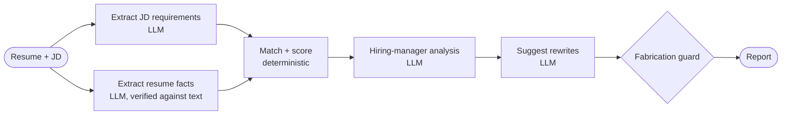

# 🎯 JobFit: honest resume ↔ job-description matching


Paste a job post, upload your resume, and JobFit tells you how well you fit. For every requirement it shows **the exact resume line that proves it**, flags skills you only *listed* but never showed using, rewrites your bullets in the job's language, and plans how to close the gaps.

Most resume tools pad resumes with keywords you don't have. JobFit has a **fabrication guard**: any suggested rewrite that adds a tool, number or claim missing from your original bullet is automatically blocked.

## How it works



| Step | What it does |
|---|---|
| **Parallel extraction** | Two LangGraph branches structure the JD and the resume at the same time |
| **Hallucination check** | Skills the LLM claims are kept only if they literally appear in the resume |
| **Deterministic matching** | 40+ canonical skills with aliases (Qdrant/Pinecone → Vector Databases, k8s → Kubernetes); the same inputs always give the same score |
| **Evidence** | Each matched requirement links to the bullet that proves it; skills seen only in a skills list count as 🟡 *listed* (partial credit) |
| **Transparent score** | 60% must-have coverage + 25% nice-to-have + 15% years of experience |
| **Fabrication guard** | Drops rewrites that add any skill or number not in the original bullet |

## Quick start

```bash
git clone https://github.com/khush-ahuja/JobFit.git
cd JobFit
pip install -r requirements.txt
cp .env.example .env            # add GROQ_API_KEY (free at console.groq.com)

python cli.py samples/resume_priya.md samples/jd_genai_engineer.md
streamlit run app.py            # web UI
uvicorn api:app --reload        # REST API at localhost:8000/docs
```

Runs on Groq, OpenAI or a fully local Ollama model (`LLM_PROVIDER=ollama`).

### API

```bash
curl -F "resume=@resume.pdf" -F "jd_text=$(cat job.txt)" localhost:8000/analyze
```

Returns the score breakdown, per-requirement status with evidence, analysis, rewrites, blocked rewrites and a Markdown report.

## Project structure

```
jobfit/
  graph.py    LangGraph pipeline: parallel extraction, match, analyze, suggest, guard
  skills.py   canonical skill vocabulary, aliases, context-aware extraction
  parse.py    PDF/Markdown loading, evidence lines, years-of-experience parsing
  report.py   Markdown report
  prompts.py  all prompts
cli.py · api.py · app.py
samples/      fictional resume and two job descriptions
tests/        offline tests with a scripted LLM (no API key needed)
```

## Tests

```bash
pytest
```

15 offline tests cover alias matching, ambiguous-word handling ("rest" vs REST APIs), skills-section detection, scoring, the hallucination check, the fabrication guard, the fallback when JD extraction fails, and the API.
